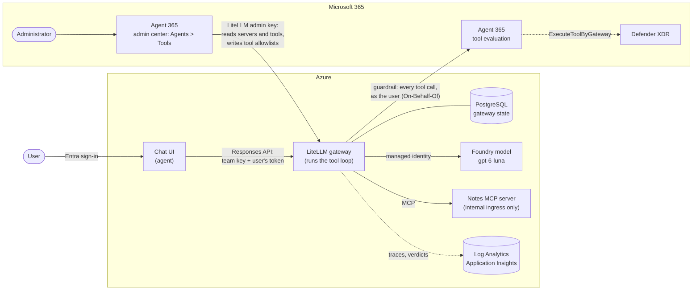
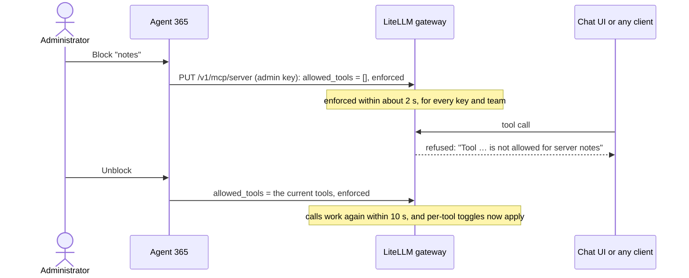

# Governing LiteLLM MCP servers with Agent 365

**Question:** When a LiteLLM gateway is connected to the Agent 365 tools gateway, what is governed: which calls a block stops and how fast, at what granularity, how new or changed MCP servers are noticed, with which identity, which controls we have in Agent 365, and with which audit records?

**Time box:** 2 days (extended for 05–07) · **Status:** done — see [the findings](docs/FINDINGS.md) · **Variant:** the same question with Azure API Management, in [spike-agent365-apim-tools-gateway](https://github.com/ikhemissi/spike-agent365-apim-tools-gateway)

## The setup

A chat app signs the user in with Entra ID and sends each request to LiteLLM's Responses API with a team key and the
user's token. **LiteLLM runs the agent's tool loop**: it calls the Foundry model with its managed identity and the
notes MCP server, which only the gateway can reach (internal ingress). Agent 365 is connected to LiteLLM with a
LiteLLM admin key: it reads the gateway's MCP servers and tools, and an administrator blocks a server or toggles
tools from the Microsoft 365 admin center, which Agent 365 writes into LiteLLM. LiteLLM's Agent 365 guardrail sends
every tool call, as the signed-in user, to Agent 365 for a Defender evaluation.



| Component | Where | Role |
|---|---|---|
| Chat UI | `services/ui`, `infra/ui` | Signs the user in; sends the conversation to LiteLLM with the team key and the user's token; shows each tool call |
| LiteLLM gateway | `infra/litellm-gateway`, `infra/postgres` | Models and MCP servers behind one endpoint; teams, keys and tool allowlists; runs the tools |
| Agent 365 guardrail | `infra/guardrail`, `src/06_configure_guardrail.py` | Sends every MCP tool call to Agent 365 for evaluation, as the user |
| Notes MCP server | `services/notes-mcp`, `infra/notes-mcp` | Two tools (`add_note`, `list_notes`) on Container Apps, reachable only inside the environment |
| Foundry model | `infra/foundry-model` | The model the chat uses |
| Agent 365 | Microsoft 365 admin center | Connected with a LiteLLM key; lists servers and tools; blocks servers and toggles tools |

## Key findings

What a block does, end to end ([04](docs/experiments/04-block-and-allow.md)):



| Question | Finding |
|---|---|
| Discovery | Servers and tools listed 48 s after the connection; a new server 63 s after its registration |
| Enforcement | A block is an empty, enforced tool allowlist written in LiteLLM; every client refused within about 2 s, restored within 10 s |
| Granularity | Per server for every team; per tool once the server is under an enforced allowlist (after one block and unblock), applied in 6–8 s |
| Drift | A changed description reaches clients at once and shows in the admin center; a new tool is refused under an enforced allowlist until enabled |
| Identity | Agent 365 holds a LiteLLM `proxy_admin` key (a read-only key is enough for discovery): keep it in a vault and rotate it, which works without downtime |
| Runtime control and audit | The guardrail evaluates every tool call as the user (+0.4–1.4 s), refuses calls without a user token, and leaves a Defender `ExecuteToolByGateway` record naming the user, the tool and the server |

The answers to every question, with the evidence: **[docs/FINDINGS.md](docs/FINDINGS.md)**.

## Documents

| Document | Content |
|---|---|
| [Questions](docs/QUESTIONS.md) | What the spike must answer, and the status of each question |
| [Experiments](docs/experiments/README.md) | One file per experiment, numbered |
| [Findings](docs/FINDINGS.md) | The answers, with links to the evidence |
| [Retest plan](docs/RETEST-PLAN.md) | What to run again when a product changes |
| [Demo runbook](docs/DEMO-RUNBOOK.md) | How to show the results |

## Environment

The infrastructure is a set of azd layers (`infra/<layer>/`, one Terraform root each), listed in `azure.yaml` in the order they are provisioned: `azure-platform`, `foundry-model`, `postgres`, `litellm-gateway`, then the spike's own `notes-mcp`, `ui` and `guardrail`. Each layer's README-level notes are at the top of its `main.tf`.

```bash
az login && azd auth login
azd env new spike-agent365-litellm-tools-gateway --location francecentral
azd env set RESOURCE_TAGS "key=value,key=value"   # tags your tenant's policies require, if any
azd hooks run preprovision                        # remote state backend (run hooks before a preview)
azd provision --preview                           # read the plan of every layer before applying
azd provision
```

The gateway: `azd env get-value LITELLM_URL`; its admin UI is at `/ui` (user `admin`), the admin key is in Key Vault:

```bash
az keyvault secret show --vault-name "$(azd env get-value PLATFORM_KEY_VAULT_NAME)" -n litellm-master-key --query value -o tsv
```

Tear it down when the spike ends: `azd down --purge`. The spike's environment was torn down on 2026-11-02; the [demo runbook](docs/DEMO-RUNBOOK.md) and the [retest plan](docs/RETEST-PLAN.md) start from a new one.

The spike adds its own layer and service: the notes MCP server on Container Apps (`infra/notes-mcp`, `services/notes-mcp`), deployed with `azd deploy notes-mcp`, then registered in the gateway with `uv run python src/01_configure_gateway.py`. The server has internal ingress only: the gateway reaches it inside the Container Apps environment, nothing outside can, so no key is involved.

## Run the experiments' code

```bash
uv sync
uv run python src/<script>.py
```
